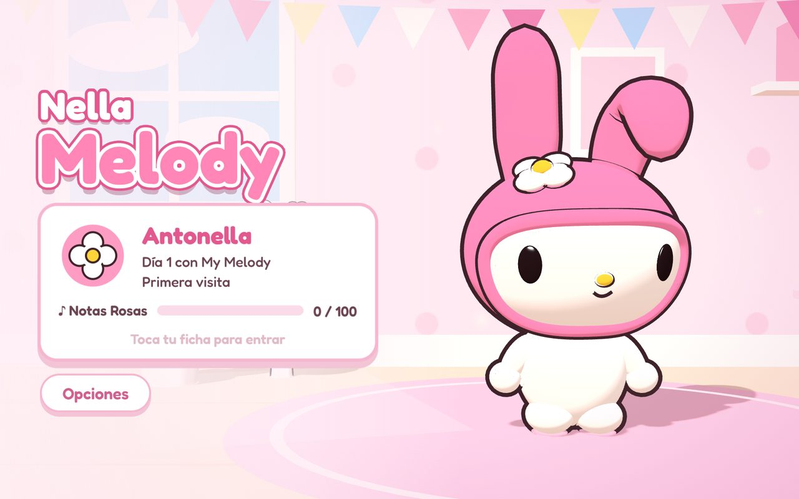
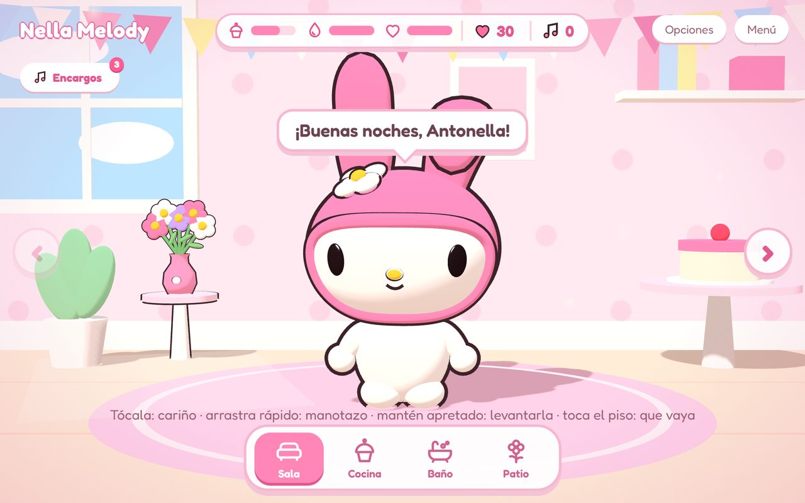
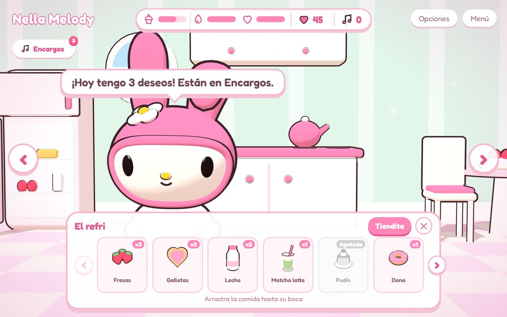
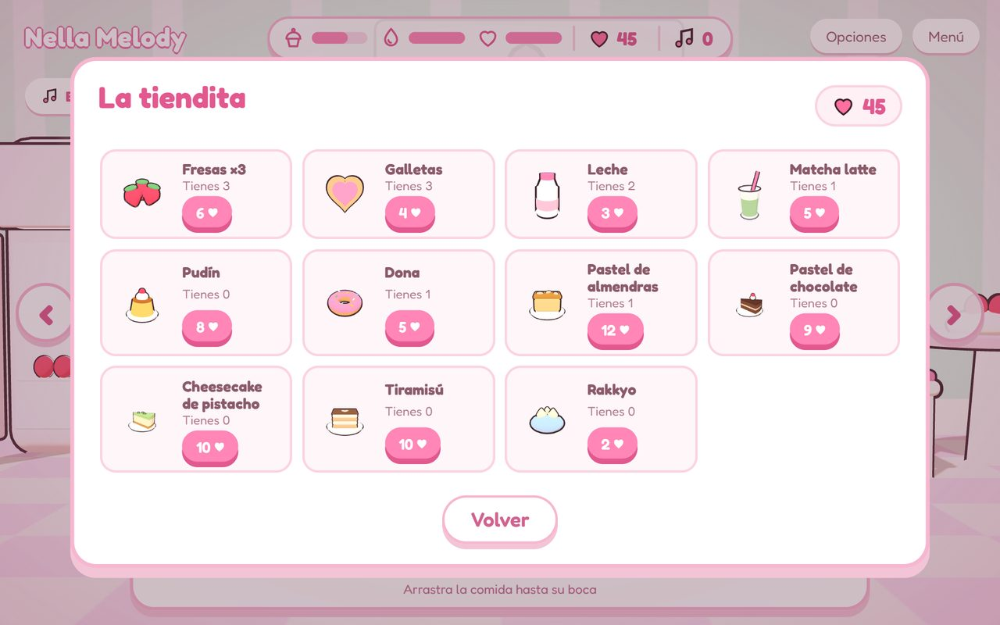
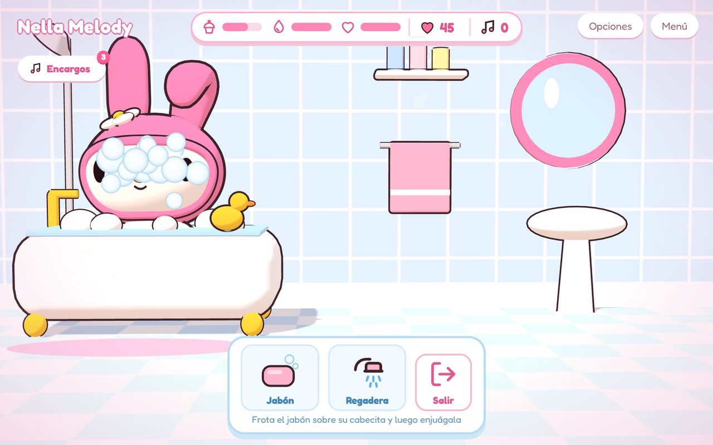
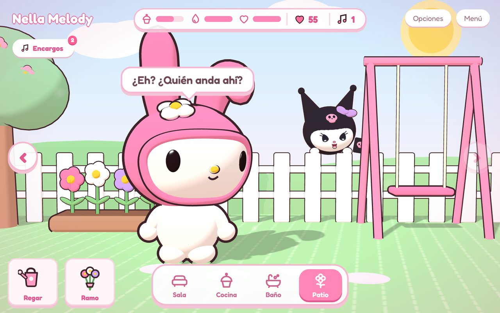
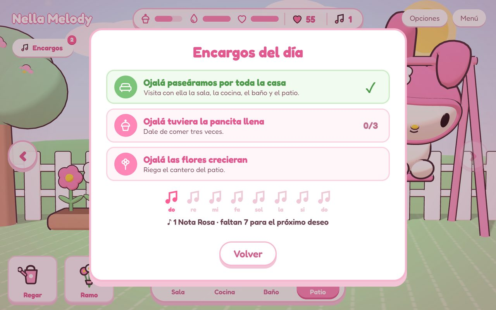
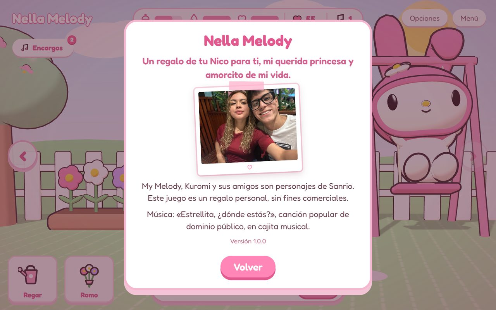
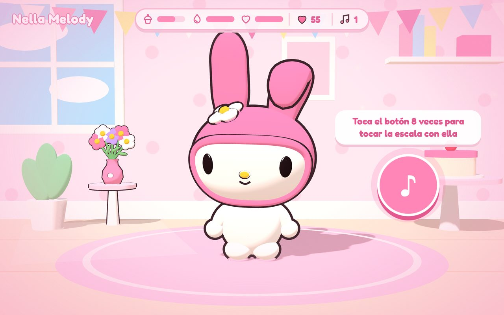

# Nella Melody

Una mascota virtual en 3D de **My Melody**, hecha a mano como regalo por Nico para su pareja, **Antonella**. 🎀

La cuidas en sesiones cortas cada día: le das cariño, de comer y un baño, la columpias y riegas sus flores. Con cada encargo cumplido junta Notas Rosas, y cada ocho notas se cumple un deseo.



| | |
|---|---|
|  |  |
|  |  |
|  |  |
|  |  |

## Qué tiene

- **Cuatro ambientes:** sala, cocina, baño y patio, con My Melody hecha en 3D por código, con contorno de tinta y sombreado de caricatura.
- **Gestos:** tocarla es cariño, arrastrar rápido es un manotazo (se bambolea como un tentetieso), mantener apretado la levanta y tocar el piso la hace caminar.
- **Cocina:** silla, refrigerador de dos páginas con 11 comidas en 3D, hambre que sube con el tiempo real y una tiendita que se paga con corazones ♥.
- **Baño:** jabón con espuma, regadera y una sacudida como de perrito. Si pasan días sin visitarla, se ensucia y se pone triste.
- **Patio:** columpio con física de péndulo (y vuelta completa si la empujas de más), flores que crecen con los días y van en ramo al florero de la sala, y Kuromi espiando por la cerca.
- **Encargos del día:** tres deseos "Ojalá…" por día. Dan Notas Rosas, cartas y páginas de la Kuromi Note. Al llegar a 100 Notas viene un final especial.
- **Sin internet:** todo va dentro del juego. Los sonidos se generan con código, sin archivos de audio.

## Jugar

- **Android (tablet):** descarga el APK de [Releases](../../releases) e instálalo. Guía en [`entrega/COMO-INSTALAR.md`](entrega/COMO-INSTALAR.md).
- **Navegador:** sirve la carpeta `prototipo-web` y abre `3d/index.html`:

  ```bash
  python -m http.server 8123 --directory prototipo-web
  ```

  Después abre <http://localhost:8123/3d/index.html>.

## Tecnología

JavaScript con módulos ES y [three.js](https://threejs.org) 0.160, sin motor de física ni compilador. Para Android se empaqueta con [Capacitor](https://capacitorjs.com) 7. Detalles para desarrollar en [`CLAUDE.md`](CLAUDE.md), y diseño y decisiones en [`docs/`](docs).

## Versiones

Se sigue [versionado semántico](https://semver.org/lang/es/) (`mayor.menor.parche`). Historial en [`CHANGELOG.md`](CHANGELOG.md).

## Créditos

- Creado por **Nico** para **Antonella**, su pareja, con todo su cariño. 💗
- Desarrollado junto a Claude (Anthropic).
- My Melody, Kuromi y sus amigos son personajes de **Sanrio**. Es un regalo personal, sin fines comerciales y sin relación con Sanrio.
- Música: «Estrellita, ¿dónde estás?», canción popular de dominio público.
- Letra [Fredoka](https://fonts.google.com/specimen/Fredoka) (SIL Open Font License 1.1) y [three.js](https://github.com/mrdoob/three.js) (MIT).

El código original está bajo licencia [MIT](LICENSE). Los personajes de Sanrio no están incluidos en esa licencia.
